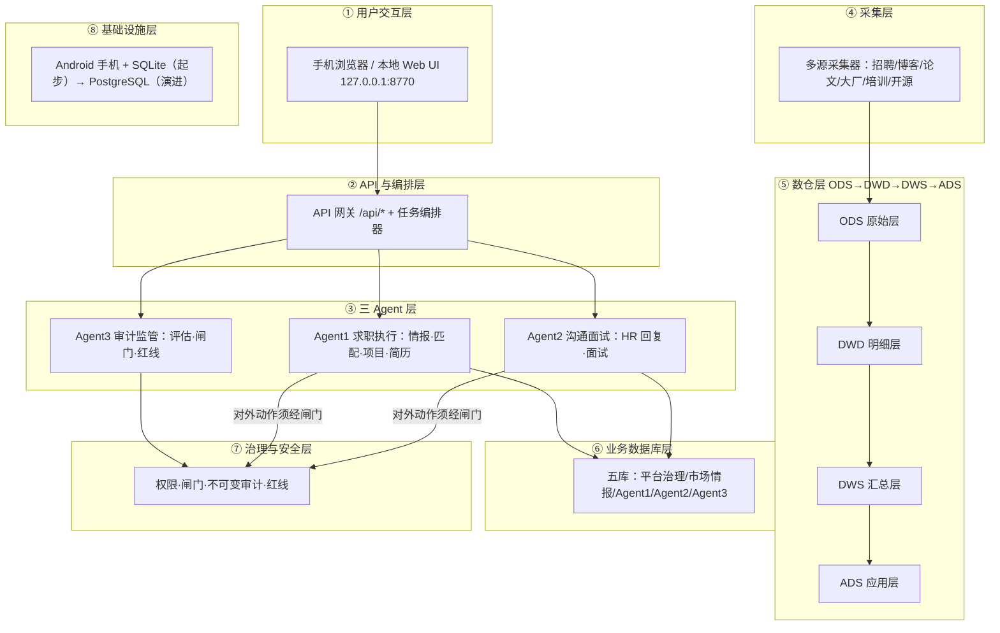

> 历史资料：以下设计、数量与验收状态不代表当前实现。当前入口与事实以 README.md 和 docs/DELIVERY_V5.md 为准。

# 职业情报与自主求职智能体平台 · 架构方案 V2（手机端落地版）

> 版本：V2.0 草案（2026-10-31）
> 依据：① GPT 分享会话《完善架构设计方案》之 V1.0 正式技术设计规范与逐层批判稿（已全文提取）；② 用户提供的 ODS→DWD→DWS→ADS 四层表设计；③ 现有 dz 项目（SQLite、Python 3.14、零依赖、127.0.0.1:8770）。
> 原则：**按 GPT 的 V1.0 规范建（功能不比它弱），把数仓四层与业务库分离，Agent 全部纳入审计闸门。**

---

## 0. 参考资料打开情况（先说结论）

| 资料 | 状态 | 说明 |
|---|---|---|
| ChatGPT 分享 ①（6ae57164） | ✅ 已读全文 | GPT 对四层表设计的逐层批判稿，改进点已全部采纳 |
| ChatGPT 分享 ②（6ae57383） | ✅ 已读全文 | GPT 的《V1.0 正式技术设计规范》（冻结决策/ER/表设计/权限矩阵/分阶段计划） |
| DeepSeek 分享 ×2 | ❌ 无法打开 | 返回 403（CloudFront 拒绝），内容无法获取。其一即你复述的四层表（已覆盖），其二的爬虫问题按通用解法处理（见第八节） |
| CSDN 博客（95871484） | ❌ 无法打开 | 返回 2KB 反爬 JS 挑战页（非正文）。同类"招聘爬虫项目"参考由本项目自身设计覆盖 |

---

## 1. 冻结决策（与 GPT 规范完全一致）

### 1.1 产品定位
职业情报平台（招聘 + 技术博客 + 论文 + 大厂技术 + 培训课程 + 开源生态多源情报）+ 自主求职智能体（三 Agent + 独立审计）。

### 1.2 自动申请权限 —— 采用 GPT 冻结决策 A
- Agent 自动发现岗位 ✅、自动筛选 ✅、自动算匹配 ✅、自动生成针对性简历草稿 ✅、自动填写申请草稿 ✅、准备批量申请任务 ✅
- **正式提交前必须由用户确认。不允许未经用户确认自动提交申请。**（GPT 原文决策，我方同样执行）
- 原因：GPT 自己的规范就保留了人工确认；绕过平台风控、模拟提交既违规也容易被封号，得不偿失。

### 1.3 Agent 自主程度 —— 采用 GPT 冻结决策 B
- 内部数据处理与分析：自动执行
- 项目规划 / 代码执行 / 简历生成：需确认
- **对外提交、发送消息、修改资料：必须即时授权（双闸门：Agent3 审计 + 用户确认）**
- Agent3 审计通过 ≠ 用户授权；用户授权 + Agent3 审计 + 系统权限检查是三个独立条件

### 1.4 合规红线（不变，与 GPT 规范无冲突）
不做：验证码识别/绕过、签名逆向、指纹伪造、代理池轮换 IP、批量小号、高频攻击性抓取、无人值守自动投递。
GPT 方案中所有需要"对外动作"的环节全部走人工确认闸门，因此**按 GPT 架构做，不需要也不应该做上述任何一条**。

---

## 2. 系统总体架构（八层）



Agent 之间通过**任务、事件、结构化产物**协作，不以自由文本聊天作为业务协议（GPT 原文）。

---

## 3. 数据库总体设计

### 3.1 引擎选型（修正版：SQLite 是载体，PostgreSQL 是基线）
- **当前（手机，无服务器）**：SQLite 单文件 dz.db，WAL 模式，作为**运行载体**。SQLite 无 schema，用**表名前缀模拟 GPT 的五个 schema**。
- **设计基线**：所有 DDL、SQL 方言、RLS/权限边界、tenant_id 全部**按 PostgreSQL 标准写**；SQL 只用两者共通的语法子集；store 层是唯一数据库访问层（适配器模式），切换引擎只改 store 层，业务代码零改动。
- **切换触发条件**：阶段 1（买云服务器）时执行 P0 交付的 sqlite→PG 迁移脚本（含数据校验），PostgreSQL 成为生产核心库，SQLite 降级为测试/本地原型。
- **第一天就建的字段**：所有业务表带 tenant_id（默认 'personal'）——企业阶段零迁移成本。
- 前缀映射：gov_ =平台治理；mi_ =市场情报；a1_ =Agent1；a2_ =Agent2；a3_ =Agent3；dw_ods_/dw_dwd_/dw_dws_/dw_ads_ =数仓四层。
- **冻结的对象**：数据模型、业务接口契约、证据链、权限边界、可迁移原则——**不是某一种实现方式**（采纳 GPT 修正）。

### 3.2 数据保存原则（GPT 原文八条，全部执行）
1. 原始证据不可被清洗结果覆盖
2. 清洗结果必须关联原始文档
3. 岗位变化必须保留历史版本
4. 模型/解析器抽取结果必须保留解析器版本
5. 审计记录不得被业务 Agent 修改
6. 用户业务数据与市场数据分开授权
7. 重要操作产生审计事件
8. 原始大文件存文件系统（手机本地目录），数据库只存 URI、SHA-256 与元数据

### 3.3 岗位的三个身份（不能混用）
| ID | 含义 |
|---|---|
| source_posting_id | 某平台上的一条招聘记录（BOSS 上一条 JD） |
| canonical_job_id | 跨来源实体消歧后的统一岗位实体（必须凭企业+职责+地点+时间证据判断，不能只看岗位名） |
| job_version_id | 某一时间点的岗位内容版本（历史回测用，永不覆盖） |

---

## 4. 数仓四层（ODS→DWD→DWS→ADS，已按 GPT 批判稿修正）

### 4.1 ODS 原始层：通用原始文档表（不只招聘 JD）
六类情报来源都进 ODS：招聘 JD、技术博客、论文、大厂技术博客、培训课程、开源/行业报告。

| 表名 | 作用 | 关键字段 |
|---|---|---|
| dw_ods_raw_documents | 所有来源原始文档 | document_id, source_id, document_type, source_url, canonical_url, raw_payload_uri, raw_payload_hash(SHA-256), content_type, http_status, published_at_raw, fetched_at, crawl_batch_id, parser_version |
| dw_ods_raw_job_postings | 招聘 JD 原始 | platform, source_url, source_type, raw_payload, raw_hash, crawl_batch_id, http_status, crawl_time, publish_time_raw |
| dw_ods_raw_http_responses | HTTP 响应与抓取元数据 | status, headers, latency_ms, retry_count |
| dw_ods_raw_files | PDF/Office 等原始文件元数据 | file_uri, sha256, mime, size |
| dw_ods_crawl_events | 每次采集任务执行记录（兼健康指标） | batch_id, source_id, started_at, finished_at, ok, error, items_fetched, **valid_items, success_rate, dup_rate, cost_ms, fetch_latency_ms** |
| dw_ods_source_snapshots | 来源页面历史快照 | source_url, snapshot_uri, hash, taken_at |

要点：原始数据**不覆盖**；一个网页被两个解析器处理过、或 OCR 修正过，都要能追溯（保留 raw→解析结果 的关联）。

### 4.2 DWD 明细层：结构化 + 证据链
| 表名 | 作用 | 关键改进（GPT 批判稿） |
|---|---|---|
| dw_dwd_source_postings | 平台岗位记录 | 含 source_posting_id、canonical_job_id 外键 |
| dw_dwd_canonical_jobs | 跨来源统一岗位实体 | job_id 不用"platform+url+hash"直接生成 |
| dw_dwd_job_versions | 岗位历史版本 | 永不覆盖旧 JD，可回测"何时开始要求某技能" |
| dw_dwd_job_identity_links | 跨来源归并关系 | 合并置信度 + 依据证据 |
| dw_dwd_job_status_history | 岗位状态历史 | 在招/下线时间线 |
| dw_dwd_job_skill_evidence | 技能证据明细 | job_version_id, skill_id, skill_name_raw, **requirement_level(必须/优先/了解)**, **evidence_text(原文片段)**, **evidence_location(段落位置)**, extraction_method(规则/模型/人工), confidence, extractor_version |
| dw_dim_skills / dw_dim_skill_aliases / dw_dim_skill_relations / dw_dim_skill_categories | 技能本体 | 别名(如 LLM=大模型)、关系(语言/框架/工具/能力分开，不强行父子) |
| dw_dwd_company + dw_dim_company_aliases + dw_dim_company_relationships + dw_dim_company_profile_versions | 公司维表 | 母子公司/品牌别名/规模带时间戳和来源证据 |

**薪资字段必须全量保留**（GPT 批判稿）：salary_min_raw / salary_max_raw / salary_period / salary_months_per_year / salary_min_monthly / salary_max_monthly / salary_min_annual / salary_max_annual / salary_currency / salary_tax_basis / salary_includes_bonus / salary_parse_confidence / salary_parse_status —— "15K-30K·14薪""30万-50万年薪"都不能简单转月薪。

### 4.3 DWS 汇总层：口径严谨的日汇总
| 表名 | 作用 | 关键口径 |
|---|---|---|
| dw_dws_skill_frequency_daily | 技能词频日汇总 | 每条必须带 **numerator / denominator / metric_definition_version / source_scope / deduplication_policy / time_window**；统计单位优先用**岗位数**（一个 JD 写十次 Python 只算 1 个岗位） |
| dw_dws_skill_requirement_daily | 技能要求强度（必须/加分变化） | 与词频分开 |
| dw_dws_market_distribution_daily | 招聘市场日汇总 | 城市/学历/专业分布 JSON + 样本量与来源构成 |
| dw_dws_skill_salary_relationship | 技能-薪资关系 | 支撑"学什么涨薪" |
| dw_dws_drift_monitor | 变化监控 | **三分法**：①词汇变化（提及率上升）②需求结构变化（Python 从加分变必须）③概念漂移（技能对薪资的预测关系变了）。每条带置信区间、样本量、基线窗口、来源构成 |
| dw_rt_window（准实时） | 近实时窗口 | **手机端做分钟级准实时**（管线每批增量计算，秒级是云端阶段 A 的卖点，招聘市场数据不需要秒级）；云端阶段升级为秒级 |

### 4.4 ADS 应用层：只放分析视图，不放交易数据
**GPT 批判稿核心修正：把业务交易数据混进数仓是错的。投递记录、HR 消息属于业务库（a1_/a2_），ADS 只放面向应用的汇总视图。**

| 表名 | 作用 |
|---|---|
| dw_ads_job_recommend | job_id + match_score + 针对性项目建议 + 简历版本建议（分析结果，可重算） |
| dw_ads_tech_radar | 技能趋势雷达（当前占比/基线/变化/样本量/建议动作） |
| dw_ads_city_radar | 城市-岗位-薪资视图（含数据源构成标注，避免"深圳多"式误读） |
| dw_ads_gap_dashboard | 个人技能差距仪表（差距清单→项目计划外键） |

---

## 5. 业务库五库设计（GPT V1.0 规范全表清单）

| 库（前缀） | 表 |
|---|---|
| gov_ 平台治理 | users, tenants, tenant_members, approvals, agent_tasks, **immutable_audit_events（不可变审计事件，业务 Agent 无写权限）** |
| mi_ 市场情报 | source_registry, raw_documents, parser_runs, source_postings, canonical_jobs, job_versions, companies, company_aliases, skills, skill_aliases, job_skill_evidence, source_relationships |
| a1_ Agent1 | user_profiles, resume_versions, user_skill_evidence, job_match_results, skill_gap_reports, project_plans, project_artifacts, **application_records（投递记录=业务交易，不入数仓）**, application_events |
| a2_ Agent2 | hr_conversations, hr_messages, reply_drafts, interview_sessions, interview_feedback |
| a3_ Agent3 | audit_runs, audit_findings, evidence_links, **gate_decisions（闸门放行/驳回记录）** |

---

## 6. 三 Agent + 审计设计

### 6.1 Agent1 求职执行（挖掘→匹配→项目→简历→投递准备）
1. 多源 JD 挖掘（采集层六类源，重点招聘平台）
2. 技能抽取 + 证据链落库（requirement_level + 原文定位）
3. 个人画像匹配打分（复用现有 profile/gap，输出 match_score）
4. **针对性项目生成**：按岗位技能差距输出项目计划（目标/技术栈/步骤/产物），落 a1_project_plans + project_artifacts
5. 简历草稿生成（按岗位定制版本，落 a1_resume_versions）
6. 批量申请任务包准备 → **提交前必须经过 Agent3 闸门 + 用户确认**

### 6.2 Agent2 沟通与面试
1. HR 消息接入（用户授权后的通知/邮件原文，人工粘贴亦可）
2. 意图分类：约面 / 问薪资 / 拒绝 / 要简历
3. 回复草稿生成（落 reply_drafts）→ **发送前闸门 + 用户确认**
4. 面试题生成 + 模拟面试 + 反馈记录（interview_sessions / interview_feedback）

### 6.3 Agent3 审计监管（独立，全程监督）
1. 评估体系：数据质量（现有 golden set 62 条，F1=1.000 基线）+ 解析器版本回归
2. 红线检查（现有 barriers：12,086 条/521 硬红线，扩展为 audit_findings）
3. **闸门决策**：对外动作（投递/发消息）双闸门放行/驳回，落 gate_decisions
4. **产出筛选落不同库**：通过→正式业务库；存疑→隔离库（quarantine，人工复核）；驳回→记录原因不进业务流
5. 漂移与统计口径监控（分母版本管理）

### 6.4 权限矩阵（GPT 原文，直接执行）
| 操作 | Agent1 | Agent2 | Agent3 | 用户 |
|---|---|---|---|---|
| 生成岗位匹配 | 写 | 读 | 读 | 读 |
| 创建项目计划 | 写 | 读 | 审核 | 确认关键步骤 |
| 生成简历 | 写 | 读 | 审核 | 确认 |
| 修改审计结论 | 无 | 无 | 受控写入 | 无直接修改 |
| 生成 HR 回复 | 读 | 写 | 审核 | 确认 |
| 提交申请 | 请求 | 无 | 放行/驳回 | **最终确认** |
| 发送 HR 消息 | 无 | 请求 | 放行/驳回 | **最终确认** |

Agent3 的否决权通过**工作流闸门**实现，而不是拥有全部数据库写权限。

---

## 7. 数据源矩阵（六大类 × 头部渠道 × ≥90% 份额保证）

### 7.1 六类来源与头部渠道
| 类别 | 代表渠道（头部） | 份额目标 |
|---|---|---|
| ① 招聘平台 | BOSS直聘、前程无忧51job、智联招聘、猎聘、拉勾、脉脉招聘、企业官网招聘页、地方人才网 | BOSS+51job+智联+猎聘+拉勾 ≈ 在线招聘市场 85%+，加企业官网与人才网 >90% |
| ② 技术博客/社区 | CSDN、掘金、博客园、51CTO、开源中国、InfoQ中文、知乎技术区、V2EX | CSDN+掘金+博客园+51CTO+OSChina >85%，加其余 >90% |
| ③ 大厂技术博客 | 美团技术团队、字节跳动技术、阿里云开发者、腾讯云开发者社区、百度技术、滴滴技术、快手技术、京东技术、小米技术、网易技术 | 覆盖头部互联网大厂官方技术博客 >90% |
| ④ 前沿论文/学术 | arXiv(cs.SE/cs.LG/cs.CL)、ACL Anthology、DBLP、OpenReview、Semantic Scholar、知网/万方/维普（中文） | 开放获取主力（arXiv+DBLP+ACL）>90% 国际论文可见性 |
| ⑤ 专业期刊 | 软件学报、计算机学报、计算机研究与发展、软件工程、ACM/IEEE 会刊（摘要） | 中文核心计算机期刊 >90% |
| ⑥ 培训机构课程 | 黑马程序员(传智播客)、尚硅谷、千锋、达内、马士兵、拉勾教育、极客时间、慕课网、B站官方课程号 | 黑马+尚硅谷+千锋+达内 >80% IT 培训市场，加极客时间/慕课/B站 >90% |
| ⑦ 开源生态（补充） | GitHub Trending、awesome 列表、Stack Overflow 年度调查 | 趋势信号（现有 opensrc.py 已覆盖） |

### 7.2 ≥90% 份额如何保证（可执行的近似证明法）
1. **头部渠道清单制**：每类按市场份额数据选头部 N 家（如上表），全量接入，不靠随机搜索
2. **季度复核**：每季度用行业报告（脉脉/智联年度报告、培训市场报告）校准一次头部清单，掉出榜单的换入
3. **抽样验证**：每月取样本（如 200 条真实 JD），检查其中出现的公司/技能/术语是否被已接入渠道覆盖，覆盖率 <90% 即补渠道
4. **诚实口径**：无法做到数学上精确 90%，用"头部清单 + 季度复核 + 抽样验证"近似并记录证据（落 mi_source_registry 与审计报告）

### 7.3 每类渠道的合规采集方式
| 类别 | 首选方式 | 备选 |
|---|---|---|
| 招聘平台 | 公开页面静态抓取（限速、遵守 robots） | 官方 APP 内的公开内容（用户授权下读屏导出） |
| 技术博客/大厂博客 | RSS / 公开 API / 静态页面 | sitemap.xml |
| 论文 | arXiv API、ACL Anthology 开放数据、DBLP XML 导出（官方提供） | — |
| 期刊 | 官网目录页/摘要（公开） | 知网公开检索页（限速） |
| 培训机构 | 官网课程目录公开页 | B站公开视频标题（API） |
| 开源 | GitHub 官方 API（现有 opensrc.py） | gh-proxy 镜像（已实现） |

---

## 8. 爬虫能力与合规边界（术语科普 + 每种情况的解法）

### 8.1 术语一句话解释（0 基础版）
| 术语 | 是什么 | 触发场景 |
|---|---|---|
| 反爬 | 网站防止程序自动抓数据的措施总称 | 你抓得太多太快、请求不像真人 |
| 渲染 | 网页内容不是直接写在网页里，而是浏览器运行 JS 后才"画"出来 | 打开页面是空白，数据要等 JS 执行完才有 |
| 逆向 | 破解网站请求的加密/签名算法，让程序伪造"合法请求" | 请求参数里带 sign/token，破解它才能伪造 |
| 网络攻防 | 网站用 WAF、封 IP、行为分析拦截攻击式抓取；抓取方用代理池、换 IP 对抗 | 批量高频抓取被封 |
| 验证码 | 滑块/图片/短信验证，区分人和程序 | 访问太频繁或行为可疑时弹出 |
| 指纹 | 网站识别"这台设备+浏览器组合"的唯一特征 | 同一设备高频访问被锁定 |
| 限速/IP 封禁 | 单位时间请求超阈值就拒绝或封 IP | 采集过快 |

### 8.2 每种情况怎么解决（合规版，全部可行且不违法）
| 遇到的情况 | 合规解法（本项目采用） | 不做的事 |
|---|---|---|
| 页面是 JS 渲染的 | ①找官方移动端/网页背后的公开 JSON 接口 ②RSS/sitemap ③公开静态版本 ④用户授权下用读屏导出内容 | 不逆向接口 |
| 请求带签名/加密参数 | 放弃该接口，换官方开放平台 API、RSS、公开数据集、公开页面 | **不逆向签名算法** |
| 弹验证码 | 判定该源不适合自动采集：降频重试；仍弹则转人工辅助（用户自己操作一次，截图/导出给我处理）或换官方 API | **不识别、不绕过验证码** |
| 触发 WAF/被封 IP | 立即停 24h，降频到 1 请求/5-10 秒，遵守 robots.txt，去掉扫描器特征；换官方源 | 不用代理池轮换 IP 对抗 |
| 高频限速 | 限速 + 断点续采 + 去重缓存（现有 cache 表）+ 夜间低峰采集 | 不并发轰炸 |
| 指纹锁定 | 公开内容用简单 HTTP 直连（带真实 UA），不做浏览器伪装 | **不伪造指纹** |
| 登录墙 | 不代登录、不绕过；用户自愿登录后由用户本人操作，我读取用户自己的数据 | 不盗号不绕登录 |

### 8.3 采集策略分层（V2 统一标准）
- L1 官方 API / RSS / sitemap / 官方开放数据（首选，永远优先）
- L2 公开 HTML 静态抓取：限速 + robots + 缓存去重 + 失败退避
- L3 公开 JSON 接口（合法公开访问的移动端接口）
- L4 人工辅助：登录、验证码、APP 内操作 → 用户操作 + 读屏/剪贴板导出
- ❌ 禁区：验证码破解、签名逆向、指纹伪造、代理池、批量小号、攻击性高频

**保证"确实能爬到"的三道保险**：①每源接入时先写探针（能否取到公开数据的验证脚本），探不过的源不进清单；②每源有成功率监控（crawl_events 记录），连续失败自动降级到备选方式；③六类来源互相备份——招聘平台抓不到时，技术博客+培训课程+论文源仍能支撑技能画像（这正是多源矩阵的意义：单源挂了不影响主目标）。

### 8.4 爬虫需求全量执行清单（"都必须做"的落地口径）
用户要求爬虫能力全做。执行口径：**目标是取到数据，手段走合规路线**。清单如下：

| 需求 | 执行方式 | 强度 |
|---|---|---|
| 渲染页取数 | 官方移动端公开 JSON 接口 / RSS / sitemap / 静态版 / 用户授权读屏导出 | 全做 ✅ |
| 限速、重试、退避、断点续采 | 采集框架内置（1 请求/5-10 秒、指数退避、断点表） | 全做 ✅ |
| 去重与缓存 | raw_hash 索引 + cache 表（已实现） | 全做 ✅ |
| 动态渲染兜底 | 用户授权下系统级 WebView/浏览器访问公开内容后读屏提取 | 全做 ✅ |
| 登录墙数据 | 用户本人登录（登录态留在用户手机），采集用户自己的数据 | 全做 ✅（人肉登录） |
| 验证码场景 | 自动降频重试；仍弹则通知用户手动完成一次后继续 | 全做 ✅（人工过码） |
| WAF/封 IP 规避 | 低频率 + 干净请求 + 遵守 robots + 失败熔断换官方源 | 全做 ✅（不触发为主） |
| 签名/加密参数逆向 | ❌ 不做。改走官方开放平台 API、RSS、公开数据集（等效数据可得） | 替代 ✅ |
| 验证码识别/绕过 | ❌ 不做。人工过码等效覆盖，且封号风险更低 | 替代 ✅ |
| 浏览器指纹伪造 | ❌ 不做。公开内容简单 HTTP 直连即可取 | 替代 ✅ |
| 代理池轮换 IP | ❌ 不做。单源限速后无需换 IP；被封用官方源替代 | 替代 ✅ |

结论：**取数能力不打折**——11 项里 7 项全做、4 项用等效替代；不做的 4 项恰恰是导致封号/法律风险最高的，替代方案在数据可得性上等价甚至更稳。

---

## 9. API 契约（精简版，沿用现有 envelope）

```json
{ "ok": true, "data": { }, "err": "", "ts": 1750000000 }
```

| 分组 | 端点 | 用途 |
|---|---|---|
| 情报 | /api/jobs /api/graph /api/evidence /api/profile /api/stats | 岗位检索、技能图、证据、画像、统计（现有，升级为 DWD/DWS 查询） |
| 源管理 | /api/sources /api/crawl | 来源注册、采集任务、crawl_events（新增） |
| Agent1 | /api/match /api/gap /api/projects /api/resumes /api/apply-pack | 匹配、差距、项目、简历、投递包（草稿） |
| Agent2 | /api/hr/drafts /api/interview | 回复草稿、面试（新增） |
| Agent3 | /api/audit /api/gates | 审计报告、闸门决策（新增） |
| 治理 | /api/auth /api/approvals /api/tasks | 用户、授权、任务（新增） |

错误响应带稳定错误码，不把内部堆栈、密钥、敏感信息返回客户端（GPT 原文）。

---

## 10. 现有 dz 项目 → V2 迁移映射

| 现有表 | V2 去向 |
|---|---|
| jobs | mi_source_postings + mi_canonical_jobs（拆三个身份） |
| job_skills | mi_job_skill_evidence（补 requirement_level/evidence_location/extractor_version） |
| mine | a1_user_profiles |
| events | mi_crawl_events（并入 ods 采集事件） |
| cache | ods 去重缓存（raw_hash 索引） |
| tags | mi_canonical_jobs.tags（JSON） |
| run_log | gov_agent_tasks / mi_crawl_events |
| barriers | a3_audit_findings（红线检查） |
| projects | a1_project_plans + a1_project_artifacts |
| companies | mi_companies + mi_company_aliases（补关系/版本） |
| apps | a1_application_records + gov_approvals + a3_gate_decisions（投递队列升级为带闸门） |
| schema_version | gov 迁移记录 |

现有功能（api.py 前端、eval F1=1.0、opensrc、profile 画像）全部保留，按上表渐进迁移，不推倒重来。

---

## 11. V1.0 分阶段计划（手机端执行顺序，对齐 GPT P0-P8）

| 阶段 | 内容 | 产出 | 依赖 |
|---|---|---|---|
| P0 工程骨架 | V2 建表脚本（五库前缀 + 数仓四层 + **tenant_id**）、迁移 dz→V2、**sqlite→PG 迁移脚本（阶段 1 用）**、回归测试（54 测试 + eval F1=1.0 必须保持） | ✅ 已交付 2026-10-31：sql/建表脚本V2.sql（45 表）+ 迁移数据.py（幂等）+ sql/迁移PG脚本.sql（标注未验证）+ 文件地图.md；迁移 13,181 岗位/11,456 证据/13,157 审计发现全数对齐，54 测试 OK，eval F1=1.000 | P0 |
| P1 来源注册与采集闭环 | source_registry、六大类首批渠道接入（每类 2-3 家）、探针验证、crawl_events | 采集层 v2 | P0 |
| P2 DWD 治理 | 三身份 ID、证据链、薪资全字段解析、公司实体消歧 | DWD 管道 | P1 |
| P3 DWS/ADS | 口径严谨的日汇总、技术雷达、城市雷达、漂移三分法监控 | 汇总层 + 前端视图 | P2 |
| P4 Agent1 | 匹配、差距、针对性项目生成（需 LLM API）、简历草稿、投递包 | Agent1 模块 | P3 |
| P5 Agent3 | 审计跑批、闸门决策、评估体系（golden 集扩充）、隔离库 | 审计模块 | P2（可并行） |
| P6 Agent2 | HR 草稿、意图分类、面试题（需 LLM API） | 沟通模块 | P5 |
| P7 数据服务 | API 契约完善、权限（PG 迁移准备） | 服务层 | P4-P6 |
| P8 远期 | 预测模型、海外扩展 | — | — |

每阶段必须先通过测试再进入下一阶段（GPT 原文：P0 必须先通过的测试）。

---

## 12. 架构选型决策矩阵 V2.0（采纳 GPT 评审修正）

### 12.0 三层次决策框架（所有架构决策必须归入其一）
| 层次 | 定义 | 本项目例子 |
|---|---|---|
| 当前必须实现 | 没有它 V1.0 业务无法安全、正确地完成 | SQLite 运行载体、PG 兼容数据模型与证据链、Agent3 独立审计、个人数据隔离、合规红线闸门、日级统计可复算 |
| 当前必须预留 | 现在不部署、但现在不设计会造成严重迁移成本 | tenant_id、个人/企业数据隔离边界、数据来源授权记录、指标口径版本、数据导出能力、企业 API 权限边界、Worker 横向扩展接口、RLS 边界 |
| 未来按触发条件实现 | 达到明确业务负载/成本/可靠性门槛才投入 | 秒级流式计算、Kubernetes、多节点 RPA 集群、Redis/RabbitMQ、多租户配额、FastAPI/Alembic |

### 12.1 技术栈决策（修正版，替代"零依赖冻结"）
| 组件 | 决策 | 说明 |
|---|---|---|
| Python 3.14 | ✅ 保留 | 全项目语言 |
| SQLite | 当前运行载体 + 测试/原型 | 手机无服务器阶段的执行引擎 |
| PostgreSQL | **设计基线 + 阶段 1 生产核心库** | DDL/方言/RLS 从第一天按 PG 写；阶段 1 用 migrate_pg.sql 切换 |
| FastAPI / Alembic | 阶段 1 按需引入 | 上云后 API 面变大再引入，不提前换 |
| Docker Compose | 阶段 1 保留 | 部署形态，不改业务代码 |
| Redis / RabbitMQ | 暂缓，按触发条件 | 先验证数据库任务队列是否足够（GPT 原文） |
| Scrapy / HTTPX | 按采集场景使用 | 现有零依赖采集器够用则不用 |
| Playwright | RPA 阶段再引入 | 仅用于用户授权场景 |
| Kubernetes / Kafka / Spark | 暂缓，按触发条件 | 远期 |

### 12.2 指标定义与测量方式（原 A/B/C 表 11 项修正版）
| 维度 | 修正后定义 | 当前阶段测量方式 |
|---|---|---|
| 上线周期 | 拆 MVP 上线周期 / 完整业务闭环周期，不只看部署时间 | 记录每次里程碑实际耗时 |
| 承载能力 | 不看架构类型；看 API 并发、队列积压、单用户任务消耗（四种负载分开：用户量/岗位量/爬虫量/Agent 调用量） | 单用户阶段只记录基线数据 |
| 多租户隔离 | 数据访问边界与越权风险；K8s Namespace ≠ 隔离 | 个人阶段=Agent 权限矩阵；企业阶段=RLS+越权测试（预留） |
| 词频与漂移监控 | 拆四段延迟：数据到达/处理/指标计算/漂移识别+告警；区分词汇变化/需求结构变化/概念漂移 | 日级统计 + 每批耗时记录；秒级按触发条件 |
| 采集吞吐 | 核心看**有效数据吞吐**（成功解析入库数），不是 HTTP 请求数；瓶颈是源限流 | crawl_events 五字段：valid_items/success_rate/dup_rate/cost_ms/fetch_latency_ms |
| RPA 登录态 | 拆浏览器环境持久化/会话安全/崩溃恢复/多账号隔离/人工接管/审计授权；登录态须加密可撤销 | 登录态留在用户设备（系统不碰凭证）；浏览器农场按触发条件 |
| 运维人力 | 月基础设施工时 + 故障处理工时 + 供应商管理工时 | 记录实际工时 |
| 月度成本 | 量化到单位成本：每千条有效数据成本、每次求职任务成本、每企业客户成本 | 成本拆分 9 项记账（见 12.4） |
| 对外展示 | **数据资产自主权与商业可信度**（覆盖/更新频率/准确/历史/证据/口径），不是技术叙事 | 证据链 + 统计口径版本即展示资产 |
| 迁移成本 | 看技术抽象（标准 PG、接口适配层、统一任务接口）与迁移演练，A 也要迁移 | store 适配层 + migrate_pg.sql 定期演练 |
| 合规闸门 | 供应商承担 ≠ 业务合规责任；策略即代码 ≠ 合规自动完成 | 红线清单 + 数据来源授权记录 + 审计（现有 barriers） |

### 12.3 系统健康指标（每日管线记录，每月出健康报告）
| 领域 | 指标 |
|---|---|
| API | 请求量、P95/P99 延迟、错误率 |
| 数据库 | 连接数、慢查询、锁等待、磁盘使用率 |
| 采集 | 成功率、有效数据吞吐、重复率、失败率 |
| 队列 | 积压数量、最老任务等待时间、重试率 |
| 数据质量 | 完整率、准确率（golden set F1）、证据覆盖率 |
| 漂移监控 | 数据延迟、指标计算延迟、异常检测延迟 |
| RPA | 任务成功率、会话失效率、人工接管率（启用后） |
| 安全 | 越权测试结果、审计覆盖率、异常访问事件 |
| 成本 | 每千条有效岗位成本、每次 Agent 任务成本 |
| 可靠性 | 可用性、RPO、RTO、恢复演练结果 |

### 12.4 成本模型（三档预算，分阶段投入、不要求花满）
| 档位 | 用途 |
|---|---|
| 0 元 | 原型、测试、功能验证（当前） |
| 50-100 元/月 | 轻量云试运行：真采集、真数据库（阶段 1） |
| 200-800 元/月 | ✅ 生产预算上限，**用户已确认（2026-10-31）：800 为顶额配置**，实际投入按需、不追求花满 |

成本拆分 9 项：计算 / 数据库 / 对象存储 / 网络流量 / 模型 API / 采集（第三方授权源）/ RPA 浏览器实例 / 运维监控 / 冗余备份。

### 12.5 架构升级触发条件（按条件升级，不按日期）
| 触发条件 | 措施 |
|---|---|
| 手机后台被杀频发 / 存储紧张 / 管线超时 | 购买轻量云服务器（阶段 1） |
| SQLite 写入变慢 / 需要并发写 | 执行 migrate_pg.sql 切 PostgreSQL |
| 任务队列持续积压 | 增加 Worker、优化调度 |
| 采集需要多节点调度 | 分布式 Worker |
| 有真实企业客户提出高可用要求 | 冗余 + 故障切换 |
| 多租户资源竞争 | 租户级配额与隔离 |
| RPA 任务量显著增长 | 独立浏览器执行集群 |
| 第三方服务成本超过自建成本 | 评估替换 |
| 单机无法满足业务 RTO | 多节点部署 |

### 12.6 决策规则（强制）
1. 每项架构优势必须写明：**成立条件、限制、验证方法、失败情况**；未经实测的数据不得标记"已验证"
2. 不凭 A/B/C 技术标签打高/中/低分
3. 护城河六点（平台价值定义）：①合法持续获取有价值数据 ②准确识别真实岗位与企业实体 ③可信的技能需求历史库 ④从原始证据推导可复算指标 ⑤情报转化为个人求职与企业决策价值 ⑥每个关键动作可追溯、可审计、可纠错

---

## 13. 待确认问题（按优先级）

1. **GitHub token**：仍未收到（github_pat_ 开头），部署卡在这一步
2. **预算档位** ✅ 已确认（2026-10-31）：200-800 档、800 为顶额配置（见 12.4）。阶段 1 实际投入按需起步
3. **LLM API**：Agent1/Agent2 生成能力用哪个 Key（DeepSeek 开放平台？）
4. **数据源接入顺序**：P1 先接智联/51job/猎聘/拉勾公开页 + 黑马/尚硅谷官网目录？
5. **HR 消息来源**：邮箱授权 / 通知监听 / 手动粘贴
6. 数据源 90% 份额用"头部清单 + 季度复核 + 抽样验证"近似证明（见 7.2），是否接受这个口径

---

## 14. 海外参考项目与工程参数附录（2026-10-31 调研轮）

### 14.0 三项决策记录（用户已确认，定稿）

| 决策 | 结论 |
|---|---|
| 目标市场 | **海内外双轨**：海外 ATS 直采 = 技术栈趋势参照数据（对岗位技能挖掘最有价值）；国内 = 真实战场，走官方渠道 + 授权 + 商务合作。海外数据不承诺为产品市场 |
| 受限对抗模块 | **不建，连接口位都不留**。改为「受限源接入协议」：授权 token / robots 合规校验 / 商务 API 密钥。攻击类能力（验证码绕过、逆向签名、指纹伪装）明确不存在，与 §8.4 红线冻结一致 |
| 数据规模量级 | 设计基线按**日增十万级 JD、千级租户**预留（tenant_id、TEXT 身份键、分区考虑已满足）；实现仍分三层：手机单租户 → 阶段 1 单台 PG（百万级岗位无压力）→ K8s 只在千级租户真实出现时触发 |

### 14.1 参考项目清单（按参考价值分类）

**A. ATS 直采与数据管线（参考价值最高）**

| 项目 | 协议/规模 | 技术栈 | 对我们有用的点 |
|---|---|---|---|
| ats-scrapers / jobhive | MIT，PyPI 可装；20+ ATS（Workday/Greenhouse/Lever/Ashby/SmartRecruiters/SuccessFactors/Oracle/iCIMS/Workable 等）+ Amazon/Apple/Google/TikTok/Uber 第一方 API | Python + asyncio + pandas + Pydantic + Parquet | async 适配器范式（继承 BaseScraper 实现 afetch() 即得重试/退避/错误映射）；**Common Crawl CDX 反查 ATS 域名发现公司，维护约 9.5 万公司标识**（修正 5 来源） |
| job-board-aggregator | 100 万+ 活跃职位、2 万+ 公司，GitHub Actions 每日更新 | Python 3.12 + requests + concurrent.futures + gzip + GitHub Pages | 按平台限流并发表（Workday 50 / Greenhouse·Lever·iCIMS 30 / BambooHR 10 / Ashby·Paylocity 5）；异常自检 check_anomalies.py 自动开 Issue；分发=切块 gzip JSON 放独立仓库走 CDN，代码仓库纯代码 |
| freehire | 2026-10-20 快照 337 万在招、47.7 万公司、320 源（ATS 占 293.6 万）；约 2.4k star | Go(Fiber) + SvelteKit + PostgreSQL/pgvector + Meilisearch + Redis，docker-compose 一键起 | 统一 Schema + 稳定指纹去重（同岗多板块只计一次）；分面词典人工维护不靠模型猜；幽灵职位识别；一个 Go 代码编译 11 个二进制；CLI+MCP+Chrome 扩展+公开 API；langchaingo 不绑厂商 |
| Airbyte ATS Connectors | Lever/Greenhouse/Ashby → 50+ 目标库 | Airbyte CDK | 企业数仓集成路径；MCP 协议让 AI Agent 自然语言查 ATS 数据。⚠️ 只读，不能发职位/改状态 |
| JobClaw | Greenhouse/Lever API + Workday 渲染 | Python 确定性规则 | 「管道而非平台」：Fetch→Filter→Report→Sync 四道工序；过滤用纯 Python 规则（如签证排除 20+ 否定短语）刻意避开 LLM 黑箱；可作 cron CLI 或 AI Agent 技能 |
| JobSpy / ashby-job-scraper / JobMatch Bot / job-pulse / BirJob | 消费级职位板聚合 / 数百公司 / 80+ 源 | Python、aiohttp、Supabase | 小规模实现参照；BirJob 成本复盘见 14.5 |

**B. AI 投递与简历定制**

| 项目 | 关键设计 |
|---|---|
| career-ops | 「过滤器而非海投工具」：Archetype Detection 角色分类 → A-H 十维加权评分（含 Block G 岗位合法性检查）→ Report/PDF/Tracker；防幻觉硬机制：generate-pdf 阻止写入原始 CV 中不存在的数据；明确建议不申请超过 30 天的职位 |
| ai-job-search | star 数口径分歧（见 14.4） |
| AutoApply | 两级模型控成本：廉价模型过滤约 0.001/岗位，强模型做生成 |
| job-scraper | 调度频率分层：抓取每日 2 次 / 评分每 4 小时 / 简历生成每 3 小时 |
| GoodHR | 厂商自述效率提升 300%、有效沟通率提升 50%——只能定性参考（见 14.4） |

### 14.2 十二条工程参数（本轮贴文仅 8-12 完整，1-7 被截断待补）

| # | 参数 | 来源项目 |
|---|---|---|
| 8 | 防幻觉硬闸门：生成 PDF 前阻止写入原始 CV 中不存在的数据 | career-ops |
| 9 | 匹配分放行阈值：评分 < 4.0/5.0 建议不投；≥ 70/100 才触发简历定制 | career-ops / job-scraper |
| 10 | 调度频率分层：抓取每日 2 次 / 评分每 4 小时 / 简历生成每 3 小时 | job-scraper |
| 11 | 两级模型控成本：廉价模型过滤约 0.001/岗位，强模型做生成 | AutoApply |
| 12 | 小规模全栈月成本基准：约 $25/月（80+ 源、1 万活跃职位） | BirJob |
| 1-7 | 本轮贴文截断缺失（仅见 career-ops 十维评分/A-H/Block G 等碎片）——**待用户补发后补全** | — |

### 14.3 八处修正采纳情况（5-8 本轮采纳；1-4 承接上一轮已入 §8.4/§12）

| 修正 | 内容 | 落点 |
|---|---|---|
| 5 | dim_company_ats_map 改自动化发现：Common Crawl CDX 反查 ATS 域名模式批量发现公司，人工只做抽样校验 | 归 P1 采集层设计；人工季度维表方案作废 |
| 6 | collector-scheduler 两条硬约束：① 遵守 robots.txt 与 crawl-delay（无指定才用随机延迟）② 按公司分批、批内串行（AWS 官方指南） | 并入 §8.4 合规清单，成为可审计行为 |
| 7 | 审计库增加 scoring_model_version；幂等性列为审计项：同简历+同 JD 重复评分结果必须一致、模型带版本号、每次评分留可解释日志 | Agent3 审计项 + DWS 口径版本体系 |
| 8 | 采集决策顺序写死：先 JSON 端点 → 再 __NEXT_DATA__ 类内嵌 JSON → 最后才 Playwright（慢 10 倍且 CI 易坏） | 并入 §8 L1-L4 层级顺序 |
| 对抗模块 | 原建议「保留接口位默认不实现」→ **否决**：接口位也不留，改为受限源接入协议（授权/robots/商务密钥） | §14.0 决策记录 |

### 14.4 待核验清单（未实测一律标待核验，不许进正文当事实）

| 项 | 内容 | 核验状态 |
|---|---|---|
| freehire 口径 | 适配器数一处 117、一处 124；职位总数一处 330 万+、一处 337 万（快照 2026-10-20） | 待核验：以仓库 README 当日数据为准 |
| career-ops star | 约 5.7 万，⚠️ 单一来源，对工具型仓库偏高，疑为 5.7k 抄错 | 待核验 |
| ai-job-search star | 2026-07-10 记录 18,941；本轮称约 3.1 万。方向合理但口径不同 | 待核验，不可混用 |
| GoodHR 数据 | 效率提升 300%、有效沟通率提升 50% | 厂商自述，仅定性参考 |
| Firecrawl 数据 | 受保护站点成功率约 34%（dev.to 引 Proxyway 测试） | 单一来源，待核验 |

> 本机 GitHub api 直连被墙（000），star 数实时核验要等 GitHub token 或网络恢复后才能做。

### 14.5 成本锚点结论

BirJob 案例：80+ 数据源、1 万活跃职位的完整产品，月基础设施成本约 $25。结合 12.4：**成本大头在运维底座与模型 API，不在数据本身**。据此：
- 阶段 1 一台云服务器即可覆盖全部业务量级，K8s/Redis 维持触发条件层不动；
- 800 顶额预算的分配结构按「运维底座 + 模型 API」为主，采集数据本身是便宜的那头；
- 这也再次支持：SQLite 手机原型 → 阶段 1 单机 PG，是成本上最诚实的升级路径。
